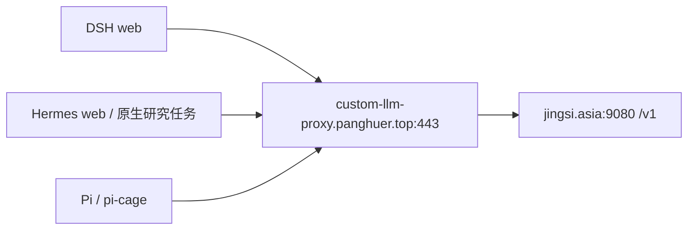

# DSH、Hermes、Pi 接入 custom-llm

记录日期：2026-10-19。本文记录三个通用 Agent 直连中转站的配置方法、已完成的修复和验证结果。

## 当前状态

| Agent | 配置入口 | 截至记录日期的结果 |
|---|---|---|
| [DSH](https://dsh.panghuer.top/) | 设置 → 模型 → 自定义提供方 | 已保存；获取模型目录成功；实际对话确认使用 `custom-llm/gpt-6-astra` |
| [Hermes](https://hermes.panghuer.top/) | 密钥、配置 YAML、模型页面 | 已提供配置步骤，用户反馈“已经可以了”；未单独验收定时研究任务 |
| [Pi](https://pi.panghuer.top/) | 首次写入 `models.json`，随后在网页终端 `/model` 选择 | 已核对运行实例、配置路径及安装包文档并提供操作步骤；尚未收到执行和对话成功反馈 |

DSH 的短对话验证不代表完整工具循环已经验收；Hermes 的用户反馈也不代替定时任务、搜索和发布链路的验证。Pi 下文是可执行教程，不能据此认定已完成配置。

## 连接参数与模型切换

| 项目 | 值 |
|---|---|
| 自定义提供方名 | `custom-llm` |
| Base URL | `https://custom-llm-proxy.panghuer.top/v1` |
| 当前模型 ID | `gpt-6-astra` |
| 协议 | OpenAI Chat Completions |
| DSH / Pi 的协议配置值 | `openai-completions` |
| Hermes 的协议配置值 | `chat_completions` |
| API Key | 中转站的上游 API Key，在各应用中单独保存 |
| 模型目录 | `https://custom-llm-proxy.panghuer.top/v1/models`，需要有效的上游鉴权 |

`custom-llm` 是应用内的提供方名，`gpt-6-astra` 才是发给上游的模型 ID。最初尝试的 `gpt-6` 和 `gpt-6-sol` 曾返回 `model_not_found`，随后按用户选择改为 `gpt-6-astra`。上游目录可能变化，以实际可用模型为准。



公共域名由 VPS `62.234.50.20` 上的 Nginx 转发到原中转站。三个 Agent 使用公网 HTTPS 443 出站；模型请求从服务端发出。客户端无需直接访问上游的 9080，也无需在自己的节点开放 9080 入站。

当前采用各 Agent 自己管理提供方和模型的方式。更换模型时，在对应应用注册或选择新的模型 ID；更换地址或密钥时，分别更新各应用的提供方配置。一个应用中的修改不会自动同步到另外两个应用。

直连配置使用中转站密钥。三个 Agent 的专用 `llm-service` 路由及网络例外已从部署方案中退役，清理范围见下节。修改 `llm-service` 的路由不会改变这里的直连模型。

## 专用网关退役

2026-10-19，用户确认三个 Agent 分别管理 `custom-llm` 提供方，授权清理此前为接入集群内网关增加的专用配置。

| 清理对象 | 原用途 |
|---|---|
| `dsh/llm-service-egress` | 允许 DSH web 访问 `llm-service` |
| `hermes/llm-service-egress` | 允许 Hermes web 访问 `llm-service` |
| `pi/llm-service-egress` | 允许当前 Pi 访问 `llm-service` |
| `llm/llm-agent-clients` | 允许以上三个 Agent 进入网关 |
| `dsh-trusted`、`hermes-trusted`、`pi-trusted` | 三个 Agent 各自的网关模型路由 |

前三条 NetworkPolicy 对应的 `dsh/k8s/llm-egress.yaml`、`hermes/k8s/llm-egress.yaml`、`pi/k8s/llm-egress.yaml` 已从仓库移除。三个 `deploy.sh` 均按目录执行 `kubectl apply`，没有单独引用这些文件。**`kubectl apply` 不会删除已从目录移除的集群资源**，已有集群需要按上表显式删除四条专用 NetworkPolicy，并同步网关配置以移除三个路由；只拉取代码和重新运行部署脚本不足以完成清理。

默认拒绝、内网隔离、DNS、登录、工具执行和公网出站策略继续保留，直连依赖现有公网 HTTPS 443 出站许可。DSH runner 与 Hermes publisher 的隔离边界继续保留。`llm-service` 的共享上游、其他业务使用的通用路由及其调用权限继续由网关维护。

退役不需要修改三个 Agent 的 `custom-llm` 提供方配置或密钥。Pi 配置和对话成功仍待用户确认；移除网关例外本身不代表 Pi 已接通模型。集群资源删除、网关路由列表与公网连通性的实际验收结果应在执行清理后补记。

## DSH：网页添加提供方

1. 打开 [DSH](https://dsh.panghuer.top/)，完成 Casdoor 登录。
2. 打开 **设置 → 模型**，添加自定义提供方；已有 `custom-llm` 时编辑原项。
3. 名称填 `custom-llm`，Base URL 填 `https://custom-llm-proxy.panghuer.top/v1`，协议选择 **OpenAI Chat Completions**（`openai-completions`），在密钥输入框填中转站 API Key。
4. 点击 **获取可用模型**，选 `gpt-6-astra` 并保存。也可手工添加这个模型 ID，不要求每次都读取目录。
5. 回到会话，通过模型选择控件或 `/model` 选 `custom-llm/gpt-6-astra`。需要新会话默认使用时，再修改默认模型；已有会话单独确认选择。
6. 发送一条短消息，并核对该轮模型标识。新建工作会话时，工作目录仍选 `/workspace`。

提供方配置由 DSH 原生用户 profile 持久化，位于网页容器 `/opt/data` 的 `dsh-home` PVC 范围。本次通过网页填写密钥；不要把含密钥的配置导出提交到 Git。原有 `dsh-model` Secret / `apiKeyEnv` 注入是另一种配置来源，修改它不等于修改网页中手工填写的密钥。

模型请求由 `dsh-web` 发起；`dsh-runner` 执行远端命令、文件与终端操作，不需要为此次模型连接另配密钥。

### 已修复的问题

| 现象 | 原因与处理 |
|---|---|
| `加载提供方目录失败: settings are unavailable in this browser` | DSH `0.1.6-alpha.2` 的设置插件只允许 loopback 页面。构建补丁为精确 origin `https://dsh.panghuer.top` 的默认同源连接启用设置读写，保留服务端认证；升级 DSH 时要复核补丁 |
| `client api: llm/discoverModels failed: Failed to fetch`，随后出现 502 / 431 | 曾同时存在地址缺少 `/v1` 和登录链路问题。旧页面在 OAuth 会话失效后持续请求 API，反复跳转登录并积累 CSRF Cookie，超过 Node 请求头大小限制；不能只归因于中转站 CORS |

OAuth 已配置 `api_routes = ["^/api/"]`：未登录或会话过期的后台 API 返回 401，根页面仍正常发起登录。这个配置不跳过认证，不能改成 `skip_auth_routes`。过期后刷新根页面重新登录；若仍报请求头过大，清除 DSH 站点 Cookie 再登录。未保存表单可能丢失，须重新填写。

修复入口与证据：

- [设置补丁](../dsh/patches/enable-trusted-web-settings.mjs)与[运维说明](../dsh/docs/operations.md)：19 项设置补丁测试及 10 项认证测试通过。
- [OAuth 配置](../../oauth/k8s/dsh-proxy-configmap.yaml)与[登录过期说明](../../oauth/k8s/DSH.md)：GET/POST、两个 API 路径、缺失/无效 Cookie 组合共 40 次验证均返回 401，未新增 CSRF Cookie，未跳转登录；根路径保持 302。
- 浏览器“获取可用模型”成功，返回 7 个 ID，包含 `gpt-6-astra`。用户发送“试验一下模型”后收到正常中文回复，该轮用量标识为 `custom-llm/gpt-6-astra`。
- 代码记录：`panghu_chat` 提交 `3cb499c`（设置补丁）；主仓库提交 `670e81d`（同步子模块）、`f41eef9`（过期 API 会话处理）。相关 OpenSpec change 为 `fix-dsh-trusted-web-settings`、`fix-dsh-expired-session-api`，位于 `armbianbegin` 独立项目，均已应用、未归档。

## Hermes：密钥页面 + YAML + 模型选择

当前部署的 Hermes 前端没有 DSH 那种完整的“添加自定义提供方”表单。可在网页完成以下三步。

### 1. 保存密钥

在 **密钥 → 自定义密钥 → 添加自定义密钥** 中，新建 `CUSTOM_LLM_API_KEY`，填入中转站 API Key 并保存。

### 2. 注册提供方

打开 **配置 → YAML**，将以下内容合并到现有配置后保存。已有顶层 `providers:` 时，在其下添加 `custom-llm`，不要重复创建顶层键或覆盖其他提供方。

```yaml
providers:
  custom-llm:
    name: custom-llm
    base_url: https://custom-llm-proxy.panghuer.top/v1
    key_env: CUSTOM_LLM_API_KEY
    api_mode: chat_completions
    default_model: gpt-6-astra
    discover_models: false
    models:
      - gpt-6-astra
```

`discover_models: false` 使用手工登记的模型列表，不依赖拉取模型目录。YAML 只引用密钥名，不填写实际密钥。

### 3. 选择模型并确认生效

进入 **模型 → Set Main Model**，选择 `custom-llm` 下的 `gpt-6-astra`。刷新聊天或 `/new` 新建会话后发送短消息，确认所用提供方及模型。

Deployment 是 `hermes/hermes-web`，容器名为 `hermes`；`HERMES_HOME=/opt/data`，配置文件为 `/opt/data/config.yaml`，存于持久卷。模型选择更新当前 profile。网页与原生调度任务共用该 profile；没有单独模型覆盖的任务使用其配置，但已有任务可能有模型设置或快照，切换后应逐项核对并通过实际任务验证。

`hermes-publisher` 负责发布已生成的内容，不使用模型，也不持有模型凭据。此次接入不需要给 publisher 添加模型提供方。

## Pi：首次写文件，之后在网页选择

当前唯一使用的实例为 **namespace `pi`、Deployment `pi`、容器 `pi-cage`**，网页入口是 [Pi](https://pi.panghuer.top/)。旧 `pi-cage` namespace 的部署、数据卷及部署配置已按用户要求删除。

已从运行容器核对：

- `PI_CODING_AGENT_DIR=/home/pi/.pi/agent`，提供方文件是 `/home/pi/.pi/agent/models.json`。
- `/home/pi` 挂在 `pi-home` PVC 上，项目文件另存 `pi-workspace`。
- 当前安装包是 `/usr/local/lib/node_modules/@earendil-works/pi-coding-agent`；其 `docs/models.md` 支持下面的配置，模型只需 `id`，不必猜测上下文长度或兼容开关。
- 容器有 Bash 和 Node，没有 Python、vi、nano；下面脚本的 Python 在管理节点执行。

### 1. 写入 custom-llm 提供方

先在自己的终端登录管理节点：

```bash
ssh root@192.168.137.101
```

在管理节点执行以下完整脚本。提示时输入中转站密钥，输入不会回显。它读取现有 JSON、保留其他提供方、替换或新增 `custom-llm`，再以权限 600 原子写入；不要把密钥输入 Pi 对话。

```bash
python3 - <<'PY'
import getpass
import json
import subprocess

k = [
    "kubectl", "--kubeconfig=/etc/kubernetes/super-admin.conf",
    "-n", "pi", "exec", "-i", "deploy/pi", "-c", "pi-cage", "--"
]
path = "/home/pi/.pi/agent/models.json"
result = subprocess.run(
    k + ["sh", "-c", f"if [ -f {path} ]; then cat {path}; else echo '{{}}'; fi"],
    capture_output=True, text=True, check=True
)
config = json.loads(result.stdout)
key = getpass.getpass("请输入中转站 API Key（不回显）: ").strip()
if not key:
    raise SystemExit("密钥为空，未修改配置")

config.setdefault("providers", {})["custom-llm"] = {
    "baseUrl": "https://custom-llm-proxy.panghuer.top/v1",
    "api": "openai-completions",
    "apiKey": key,
    "models": [{"id": "gpt-6-astra", "name": "GPT-6 Astra"}]
}
subprocess.run(
    k + ["sh", "-c",
         f"umask 077; mkdir -p /home/pi/.pi/agent && "
         f"cat > {path}.new && chmod 600 {path}.new && mv {path}.new {path}"],
    input=json.dumps(config, indent=2) + "\n",
    text=True, check=True
)
print("配置已保存，请回 Pi 网页输入 /model")
PY
```

这里的 `apiKey` 会作为明文保存在持久卷的 `models.json` 中，不进入仓库；备份也包含该密钥。Pi 同样支持密钥环境变量引用，但必须先另行配置容器注入，不能只把上面值改成一个未注入的变量名。

### 2. 在 Pi 网页选择

1. 回到 Pi 网页终端，输入 `/model`；这一步会重新加载 `models.json`。
2. 找到并选择提供方 `custom-llm` 下的 `gpt-6-astra`（显示名 `GPT-6 Astra`）。
3. 若要设为新会话默认，再次输入 `/model`，定位该模型后按 `Ctrl+S` 保存。
4. 发一条短消息验证，再新建会话确认默认模型。配置文件修改本身不要求重启或重新部署。

之后在 `/model` 中切换已经登记的模型即可。新增上游模型时，先在 `models.json` 的对应 `models` 数组加入真实模型 ID，再重新打开 `/model`。

## 排查与验收

| 现象 | 先检查什么 |
|---|---|
| 模型目录或请求返回 401 | 区分应用登录会话失效与上游鉴权失败；确认填写的是中转站 API Key |
| 404 / `model_not_found` | Base URL 是否带 `/v1`，模型 ID 是否仍在上游可用列表 |
| DSH `Failed to fetch` / 431 | 按前述 OAuth 修复说明检查会话及 Cookie；不要直接扩大网络权限或认定是 CORS |
| Hermes 下拉框没有模型 | YAML 是否正确合并、密钥名是否一致、是否保存并刷新模型页面 |
| Pi `/model` 找不到模型 | 是否写入当前 `pi/pi` 的正确目录、JSON 是否有效、是否重新执行 `/model` |
| 更换默认模型后旧对话仍用旧模型 | 检查当前会话选择，新建会话验证；Hermes 还需检查定时任务覆盖设置 |

后续验收应分别确认：提供方保存后仍可读取、短对话使用正确模型、工具调用及结果回传、多轮请求、新会话默认值。Hermes 定时研究另行验收；Pi 在用户执行上述步骤后补记结果。本文不包含实际密钥、登录凭据或未经确认的成功结论。
